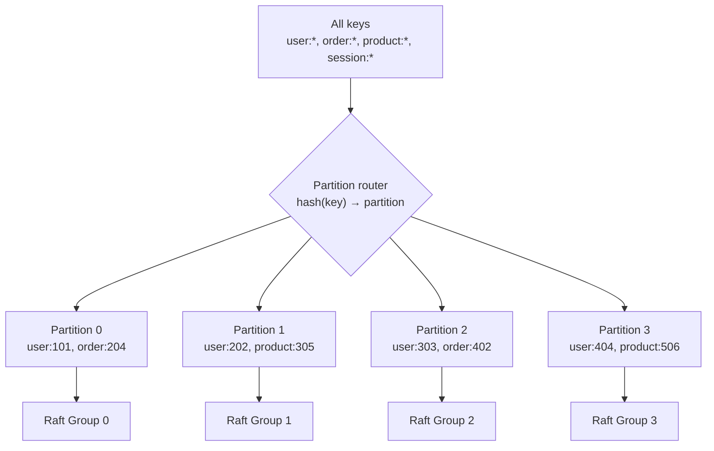
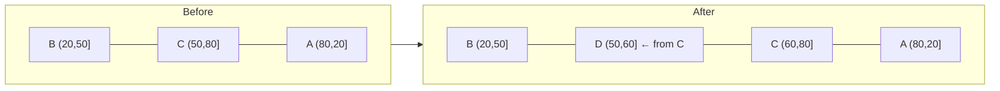
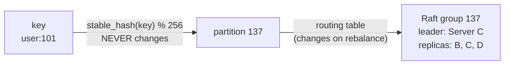
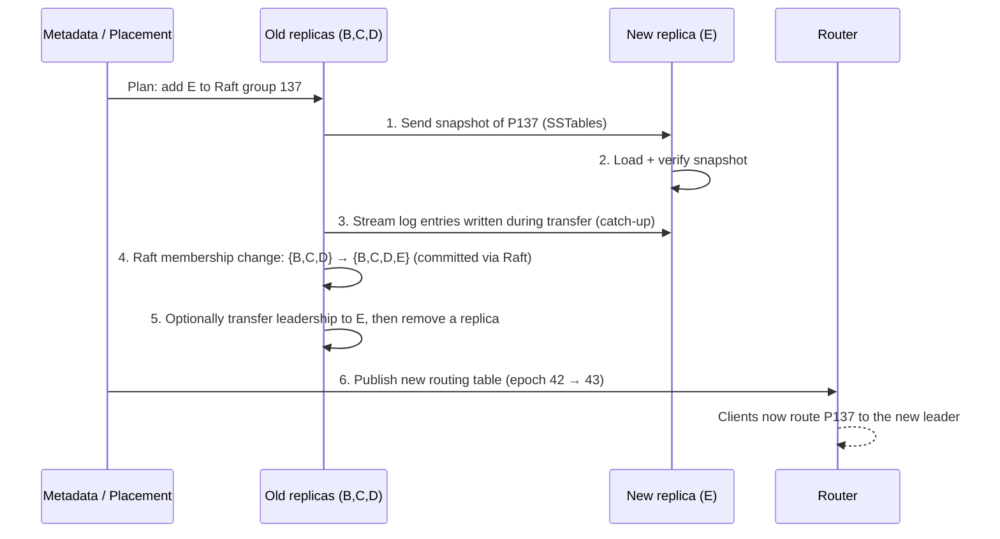
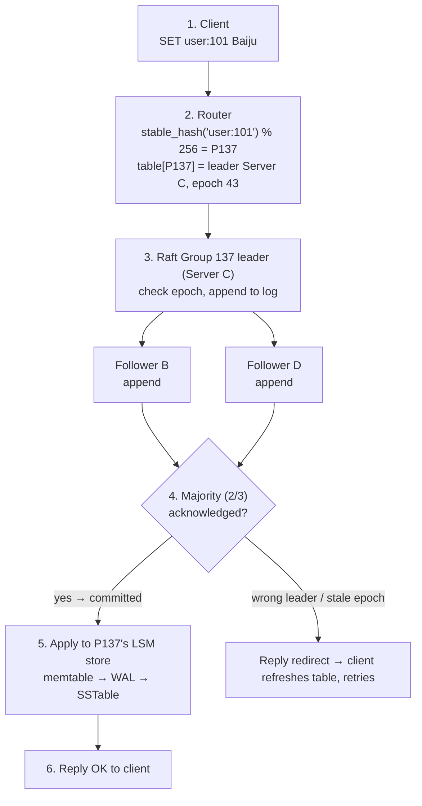

# V10 — Partitioning & Sharding: The Mental Model

> **Goal of this note:** understand *why* sharding exists, *how* consistent hashing works, *where* routing sits relative to Raft, and *what really happens* when nodes join or leave — before touching the V10 code.

---

## 0. The whole lesson in 6 lines (memorize this first)

```
1. Replication = SAME data, MANY copies      → survives failures
2. Sharding    = DIFFERENT data, MANY pieces → scales storage & throughput
3. hash % N breaks when N changes            → ~80% of keys move (4→5 nodes)
4. Consistent hashing: ring + clockwise walk → only ~1/N of keys move
5. Virtual nodes smooth out the ring         → fair load
6. Ring says WHERE a key should live; Raft says WHEN a write is committed.
   Moving the data is a SEPARATE, careful process.
```

If you forget everything else, keep these six lines.

---

## 1. Where we are: V8 + V9 recap

- **V8** — leader–follower replication.
- **V9** — Raft consensus: a leader, followers, a replicated log, a commit index.

The hidden limitation: **every replica in the Raft group stores the entire keyspace.**

```
                     Client: SET user:101 Baiju
                                 │
                                 ▼
   ┌──────────────────┐   ┌──────────────────┐   ┌──────────────────┐
   │ Server A (Leader)│──▶│ Server B (Follow)│   │ Server C (Follow)│
   │  user:101        │   │  user:101        │◀──│  user:101        │
   │  user:202        │   │  user:202        │   │  user:202        │
   │  order:501       │   │  order:501       │   │  order:501       │
   │  ... ALL keys    │   │  ... ALL keys    │   │  ... ALL keys    │
   └──────────────────┘   └──────────────────┘   └──────────────────┘
            10 TB                  10 TB                  10 TB
```

### The problem in numbers

| Dataset | Servers | Data per server | Write leaders |
|---|---|---|---|
| 10 TB | 3 | 10 TB | 1 |
| 10 TB | 6 | **still 10 TB** | **still 1** |

Adding servers to one Raft group gives you **more copies**, not **more capacity**. And every write still goes through **one leader** — that leader is your throughput ceiling.

### Analogy: the library

- **Replication** = photocopying the *entire* library and storing copies in 3 buildings. If one burns down, you're fine. But each building must be big enough for the whole library.
- **Sharding** = putting books A–F in building 1, G–M in building 2, and so on. Each building holds only part of the library.
- **Real systems do both**: split the library into sections, *and* keep 3 copies of each section in different buildings.

---

## 2. What sharding actually means

Split the keyspace into **partitions** (also called **shards**). Each partition is its own small, independent database with its **own Raft group**.



Each Raft group has its **own** leader, followers, log, commit index and LSM store. They don't know about each other.

### Partitions vs servers — two different axes

This is the part people mix up. A **partition** is a logical slice of data. A **server** is a physical machine. Each server hosts replicas of *several* partitions.

```
              Server A    Server B    Server C    Server D
              ────────    ────────    ────────    ────────
Partition 0    LEADER      follower    follower       -
Partition 1       -        LEADER      follower    follower
Partition 2    follower       -        LEADER      follower
Partition 3    follower    follower       -        LEADER
```

Read it two ways:

- **Down a column** → "What does Server A host?" → replicas of P0, P2, P3.
- **Across a row** → "Where does Partition 1 live?" → on B, C, D.

Notice three good properties:

1. **Each partition has 3 replicas** → each Raft group tolerates 1 failure.
2. **Leaders are spread out** → A, B, C, D each lead one partition → write load is shared by 4 machines, not 1.
3. **If Server A dies**, P0 loses its leader (B or C takes over), P2 and P3 lose a follower (still have a 2/3 quorum). Nothing is lost.

> **Failure domain rule:** the 3 replicas of one partition must live on machines that don't fail together — different machines at minimum, ideally different racks/zones. Three replicas on one rack = one power failure kills the quorum.

---

## 3. Why `hash(key) % num_nodes` is a trap

The obvious first idea:

```rust
fn node_for(key: &str, num_nodes: u64) -> u64 {
    stable_hash(key) % num_nodes
}
```

It works perfectly — **until the cluster size changes.**

### Walk through one key (hash = 42)

| Nodes | Calculation | Destination |
|---|---|---|
| 4 | 42 % 4 | 2 |
| 5 | 42 % 5 | 2 ✅ (lucky) |
| 6 | 42 % 6 | 0 ❌ (moved) |

### Walk through many keys (4 → 5 nodes)

```
hash:      0  1  2  3  4  5  6  7  8  9 10 11 12 13 14 15 16 17 18 19
% 4:       0  1  2  3  0  1  2  3  0  1  2  3  0  1  2  3  0  1  2  3
% 5:       0  1  2  3  4  0  1  2  3  4  0  1  2  3  4  0  1  2  3  4
same?      ✓  ✓  ✓  ✓  ✗  ✗  ✗  ✗  ✗  ✗  ✗  ✗  ✗  ✗  ✗  ✗  ✗  ✗  ✗  ✗
```

Only 4 of 20 stay. **80% move.**

### Measured (100,000 keys, Rust simulation, see §10)

| Change | Keys moved | Ideal minimum |
|---|---|---|
| `% 4` → `% 5` | **80.1%** | 20% |

Why? A key's home depends on **N** — the total node count. Change N and you change the answer for almost everyone. Adding *one* server forces you to copy ~80% of the whole database across the network. That's a migration storm.

> **The core insight:** the problem isn't that modulo is wrong. It's that the key's destination depends on a global number (N). We want the destination to depend only on **local neighbours**.

### ⚠️ Rust gotcha: "stable_hash" must actually be stable

`std::collections::hash_map::DefaultHasher` is **not** guaranteed to give the same output across Rust versions, and `RandomState` is randomized per process. If two nodes compute different hashes for the same key, they disagree about who owns it — a silent correctness bug. Use a fixed algorithm (FNV-1a, xxHash, MurmurHash3) with a fixed seed.

---

## 4. Consistent hashing: the ring

### The picture

Take the full hash range `0 … 2⁶⁴−1` and **bend it into a circle**, so the end wraps back to 0. Put **nodes** on the circle (by hashing their names). Put **keys** on the same circle (by hashing the key).

**The one rule:**

> Start at the key's position. Walk **clockwise**. The first node you meet owns the key.

Simplified ring (positions 0–99), three nodes A=20, B=50, C=80:

```
                         0 / 100
                            │
                 ●──────────┼──────────●
              ╱    k=90 ✦   │             ╲
          C(80) ◆                          ◆ A(20)
            │                                 │
            │        walk clockwise →         │
            │                                 │
            ●                                 ●   ✦ k=35
              ╲                             ╱
                 ●───────────◆───────────●
                           B(50)

    Owner ranges (each node owns the arc ENDING at it):
      A owns (80, 20]   ← wraps through 0
      B owns (20, 50]
      C owns (50, 80]
```

| Key hash | Walk clockwise… | Owner |
|---|---|---|
| 35 | next node ≥ 35 is B(50) | **B** |
| 50 | exactly on B | **B** |
| 70 | next node ≥ 70 is C(80) | **C** |
| 90 | nothing ≥ 90 → **wrap** to smallest = A(20) | **A** |
| 10 | next node ≥ 10 is A(20) | **A** |

**The wraparound is the whole trick.** The ring is a circle, not a line. Forgetting wraparound is the #1 bug in hand-written rings.

### Adding a node: only the neighbour loses keys

Add **D at 60**.

```
BEFORE                                  AFTER
─────────────────────────────          ─────────────────────────────
A owns (80, 20]                         A owns (80, 20]   unchanged
B owns (20, 50]                         B owns (20, 50]   unchanged
C owns (50, 80]   ◀── split ──▶        D owns (50, 60]   NEW (from C)
                                        C owns (60, 80]   smaller
```



- Keys only move **to the new node D**.
- They only come **from one neighbour (C)**.
- A and B are untouched — they do nothing.

**Removing a node** is the mirror image: its arc is absorbed by the next node clockwise. Only that one neighbour gains keys.

### Measured: what fraction moves when going 4 → 5 nodes?

| Scheme | Keys moved | Moved to a node that **wasn't** the new one |
|---|---|---|
| Modulo | 80.1% | lots (keys shuffle between old nodes too) |
| Consistent hashing (200 vnodes) | **19.8%** | **0** |

Ideal is exactly 1/5 = 20%. Consistent hashing hits it, and **every moved key goes to the new node** — no pointless shuffling among old nodes.

---

## 5. Virtual nodes: fixing an unfair ring

### The problem

With one position per node, positions are random — and random is lumpy.

```
Ring positions: A=5, B=10, C=90

   0 ──A──B──────────────────────────────────────────C── 100
       5  10                                          90

   B owns (5, 10]   →  5% of the ring
   C owns (10, 90]  → 80% of the ring   ← overloaded
   A owns (90, 5]   → 15% of the ring
```

Measured with 4 nodes × 1 position each (100,000 keys):

```
Node 0: ████████████████████████████████████████████████████  66,700  (2.67× average)
Node 1: ██████████                                            12,996
Node 2: ████████                                              10,418
Node 3: ████████                                               9,886  (0.40× average)
```

One node holds two-thirds of the data. That's not a distributed system — that's one overloaded server and three idle ones.

### The fix: many positions per physical node

Hash each physical node **many times** under different names:

```
"node-A-vnode-0", "node-A-vnode-1", ... "node-A-vnode-199"
"node-B-vnode-0", "node-B-vnode-1", ... "node-B-vnode-199"
...
```

Every virtual position points back to its physical node.

```
Single position:   ──A─────────────B──C──────────────────────D──

Many positions:    ─A─C─B─D─A─B─C─A─D─B─C─D─A─C─B─D─A─B─D─C─A─
                     (each arc is small, and every node gets
                      roughly the same total length)
```

Why it works: each node now owns **many small arcs** instead of **one big random arc**. By averaging many random pieces, the total evens out (same reason flipping a coin 200 times gives you close to 50% heads, but flipping it once gives 0% or 100%).

### Measured: balance vs number of vnodes

| vnodes per node | Busiest node / average | Quietest node / average |
|---|---|---|
| 1 | **2.67×** | 0.40× |
| 10 | 1.13× | 0.88× |
| 100 | 1.13× | 0.90× |
| 200 | **1.08×** | 0.95× |

### Bonus uses of vnodes

- **Unequal hardware**: a server with 2× disk gets 2× vnodes → owns ~2× data.
- **Smoother removal**: when a node dies, its many small arcs scatter to *many* neighbours, so no single node absorbs the whole load.

### What vnodes do NOT fix

- **Hot keys**: if `user:celebrity` gets 1M reads/sec, it lives on one partition no matter how balanced the ring is. That needs caching, read replicas, or key splitting.
- **Skewed workloads**: equal *key counts* ≠ equal *traffic*.

---

## 6. Rust implementation: why `BTreeMap` fits

The only question the ring ever asks is: **"What's the first position ≥ this hash, wrapping around if needed?"**

That needs **sorted** keys plus a fast "find successor" — exactly what a `BTreeMap` gives.

| Structure | Successor lookup | Insert/remove node | Verdict |
|---|---|---|---|
| `HashMap` | ❌ unordered, must scan all | O(1) | Wrong tool |
| Sorted `Vec` + binary search | O(log V) | O(V) shifting | Fine if ring rarely changes |
| `BTreeMap` | **O(log V)** | **O(log V)** | ✅ Clean default |

(V = total virtual positions, e.g. 5 nodes × 200 = 1,000.)

### Full, runnable ring

```rust
use std::collections::BTreeMap;

type NodeId = u32;

/// Stable hash: FNV-1a + a mixing step so nearby strings spread out.
/// Same input → same output on every machine, every Rust version.
fn stable_hash(s: &str) -> u64 {
    let mut h: u64 = 0xcbf29ce484222325;
    for b in s.bytes() {
        h ^= b as u64;
        h = h.wrapping_mul(0x100000001b3);
    }
    // splitmix64 finalizer — improves distribution
    h = (h ^ (h >> 30)).wrapping_mul(0xbf58476d1ce4e5b9);
    h = (h ^ (h >> 27)).wrapping_mul(0x94d049bb133111eb);
    h ^ (h >> 31)
}

pub struct ConsistentHashRing {
    ring: BTreeMap<u64, NodeId>, // ring position → physical node
    vnodes: u32,
}

impl ConsistentHashRing {
    pub fn new(vnodes: u32) -> Self {
        Self { ring: BTreeMap::new(), vnodes }
    }

    pub fn add_node(&mut self, node: NodeId) {
        for i in 0..self.vnodes {
            let pos = stable_hash(&format!("node-{node}-vnode-{i}"));
            self.ring.insert(pos, node);
        }
    }

    pub fn remove_node(&mut self, node: NodeId) {
        self.ring.retain(|_, n| *n != node);
    }

    /// Who owns this key? None only if the ring is empty.
    pub fn owner(&self, key: &str) -> Option<NodeId> {
        let h = stable_hash(key);
        self.ring
            .range(h..)                       // 1. positions ≥ h
            .next()                           // 2. take the first one
            .or_else(|| self.ring.iter().next()) // 3. none? wrap to smallest
            .map(|(_, node)| *node)           // 4. position → physical node
    }
}
```

### Read `owner()` like a sentence

```
range(h..)          "Look at every ring position from h to the end."
.next()             "Take the first one."
.or_else(...)       "If there wasn't one, I fell off the end — go back to the start."
.map(...)           "I only care which physical node that position belongs to."
```

**Why `Option<NodeId>` and not `NodeId`?** An empty ring has no owner. In a routing layer, returning `None` and letting the caller reply "cluster unavailable" is far better than a `panic!` that crashes the router.

**Hash collisions:** two vnodes hashing to the same `u64` is astronomically unlikely, but `insert` would silently overwrite one. Production code can check `insert`'s return value and re-hash with a salt.

---

## 7. The upgrade for your system: fixed partitions

Here's the design decision that matters most for V10.

### Option A — hash keys straight to nodes (what §4–6 showed)

```
key ──hash──▶ ring ──▶ node
```

Problem: when the ring changes, **individual keys** move. But in your system data isn't owned by a "node" — it's owned by a **Raft group** with its own log. Moving 3,412 scattered keys out of one Raft log into another, while both keep accepting writes, is a nightmare.

### Option B — two-level mapping (recommended)

```
key ──hash──▶ partition_id  (FIXED forever, e.g. 0..256)
partition_id ──metadata──▶ Raft group / servers  (CHANGES during rebalance)
```



**Wait — isn't that `% N` again?** Yes, but `N` here is the **number of partitions**, which you pick once (say 256) and **never change**. The thing that changes is the **number of servers**, and servers are mapped to partitions through a table. So adding a server never re-hashes any key.

| | Hash → node | Hash → fixed partition → node |
|---|---|---|
| What moves on rebalance | Scattered individual keys | Whole partitions |
| Fits Raft-per-partition | Poorly | ✅ Naturally — one partition = one Raft group |
| Migration unit | Thousands of keys | One snapshot of one partition |
| Used by | Dynamo-style systems, Cassandra (token ring) | Riak (fixed ring), Couchbase (1024 vBuckets), Redis Cluster (16384 slots), CockroachDB/TiKV (ranges) |

Rule of thumb: **pick partitions ≈ 10–100× the number of servers you expect.** With 256 partitions and 4 servers, each server hosts ~64 partitions; adding a 5th server means moving ~51 partitions to it — a fair, controllable amount.

> **Key mental shift:** the ring/table no longer decides where *keys* go. Hashing decides which *partition* a key belongs to (permanently). The table decides where *partitions* live (temporarily).

---

## 8. Hash vs range partitioning (affects your LSM store)

There are two ways to cut the keyspace.

```
HASH partitioning                       RANGE partitioning
────────────────────                    ────────────────────
user:100 → P2                           [a ... f)  → P0
user:101 → P0                           [f ... m)  → P1
user:102 → P3                           [m ... s)  → P2
(neighbours scattered)                  [s ... z]  → P3
                                        (neighbours together)
```

| | Hash | Range |
|---|---|---|
| Even load | ✅ Automatic | ❌ Can get hot (e.g. all new keys = `order:2026-10-…`) |
| Range scan `user:100..user:200` | ❌ Must ask **every** partition | ✅ One or two partitions |
| Splitting a hot partition | Hard | ✅ Natural (split the range in half) |
| Examples | Cassandra, DynamoDB, Redis Cluster | Bigtable, HBase, CockroachDB, TiKV |

**Why this matters to you:** your LSM store keeps keys **sorted** in SSTables, so it's naturally good at range scans. Hash partitioning throws that advantage away *across* partitions (scans still work *within* one). For V10, hash partitioning is the simpler, safer start — just know that you're trading away cross-partition range scans, and that range partitioning is the other road.

---

## 9. Assignment ≠ data movement (the most important section)

> The routing table saying "partition 137 now lives on Server D" is a **wish**. It is not a **fact** until the data is actually there.

If you just flip the table, this happens:

```
t1  Router: "P137 → Server D now"
t2  Client: GET user:101 → Server D → "not found"      ❌ data is still on C
t3  Client: SET user:101 X → Server D (accepted)
t4  Old client with stale table: SET user:101 Y → Server C (accepted)
                                                        ❌ two owners, two values
```

**Lost reads** and **split-brain writes**. Both are silent.

### A safe partition move, step by step



In plain words:

1. **Copy** a snapshot of the partition to the new server.
2. **Verify** it arrived intact (checksums).
3. **Catch up** on writes that happened while copying (replay the Raft log tail).
4. **Change membership through Raft itself** — the group commits "E is now a member" as a log entry. Raft's own safety rules prevent two leaders.
5. **Then** remove the old replica if needed.
6. **Only now** publish the new routing table.

**The trick for your design:** if each partition is a Raft group, a "move" is just **Raft membership change** (add learner → promote → remove old). Raft already guarantees no split brain. You're reusing V9 instead of inventing a new protocol. This is exactly how TiKV and CockroachDB move data.

### Stale routers: epochs + redirects

Clients and routers will sometimes have an old table. Protect against it:

- Every routing table has a version number: the **epoch**.
- Every request carries `(partition_id, epoch)`.
- A server that no longer leads that partition replies `WrongLeader { hint }` or `StaleEpoch { current }`.
- The client refreshes its table and retries.

```
Client (epoch 42) ──SET──▶ Server C
Server C: "I'm not P137's leader anymore. Epoch is 43. Try Server E."
Client refreshes table ──SET──▶ Server E ✅
```

Servers are the source of truth; routing tables are just a **cache** that can be wrong and is corrected on contact.

---

## 10. Full request flow through V10

```
SET user:101 Baiju
```



**Who decides what — the division of labour:**

| Layer | Decides | Does NOT decide |
|---|---|---|
| Hash function | Which **partition** a key belongs to (forever) | Where that partition lives |
| Routing table | Which **servers/leader** host a partition (now) | Whether a write is committed |
| Raft group | **Order + commitment** of writes in that partition | Which keys belong to it |
| LSM store | **How** committed data is stored and read | Anything about other partitions |

One sentence to remember: **"Hashing picks the shard, the table picks the server, Raft picks the order, LSM stores it."**

---

## 11. Simulation: see the numbers yourself

Run this standalone (no project changes). It reuses `stable_hash` and `ConsistentHashRing` from §6.

```rust
fn main() {
    let keys: Vec<String> = (0..100_000).map(|i| format!("user:{i}")).collect();

    // --- Modulo: 4 → 5 nodes ---
    let moved = keys.iter()
        .filter(|k| stable_hash(k) % 4 != stable_hash(k) % 5)
        .count();
    println!("modulo 4→5 moved: {:.1}%", moved as f64 / 1000.0);

    // --- Consistent hashing with different vnode counts ---
    for v in [1u32, 10, 100, 200] {
        let mut ring = ConsistentHashRing::new(v);
        for n in 0..4 { ring.add_node(n); }

        let before: Vec<NodeId> = keys.iter().map(|k| ring.owner(k).unwrap()).collect();
        let mut load = [0usize; 4];
        for &o in &before { load[o as usize] += 1; }

        ring.add_node(4);
        let mut moved = 0;
        let mut moved_elsewhere = 0; // moved to an OLD node (should be 0)
        for (k, &b) in keys.iter().zip(&before) {
            let a = ring.owner(k).unwrap();
            if a != b {
                moved += 1;
                if a != 4 { moved_elsewhere += 1; }
            }
        }
        println!(
            "vnodes={v:3} load={load:?} | moved={:.1}% | to old nodes={moved_elsewhere}",
            moved as f64 / 1000.0
        );
    }
}
```

Output (actual run):

```
modulo 4→5 moved: 80.1%
vnodes=  1 load=[66700, 12996, 10418,  9886] | moved=18.6% | to old nodes=0
vnodes= 10 load=[28344, 23431, 26110, 22115] | moved=24.1% | to old nodes=0
vnodes=100 load=[22421, 25200, 28145, 24234] | moved=17.1% | to old nodes=0
vnodes=200 load=[23858, 25043, 27024, 24075] | moved=19.8% | to old nodes=0
```

What to notice:

1. Modulo moves **4× more data** than necessary.
2. Consistent hashing moves close to the ideal **20%**, and **never** shuffles keys between old nodes.
3. With 1 vnode, the moved % happens to look fine but the **load** is terrible (66,700 vs 9,886). Balance and movement are two separate properties — vnodes fix balance.
4. The moved % wobbles (17–24%) because the new node's random arcs might be slightly bigger or smaller than 1/5. More vnodes → less wobble.

**Exercises to try:**
- Remove node 2 instead of adding node 4. Check that every moved key came *from* node 2.
- Give node 0 400 vnodes and the others 200. Does node 0 get ~2× the keys?
- Replace the ring with fixed 256 partitions + a `Vec<NodeId>` table. Add a server by reassigning ~51 partitions. Count how many keys move.

---

## 12. Common mistakes checklist

| ❌ Mistake | ✅ Fix |
|---|---|
| Using `DefaultHasher` / `RandomState` for routing | Fixed algorithm (FNV-1a / xxHash) with fixed seed |
| Forgetting ring wraparound | `.or_else(\|\| ring.iter().next())` |
| One position per node | 100–200 vnodes per node |
| Flipping the routing table before data is copied | Snapshot → catch-up → Raft membership change → *then* publish |
| Assuming the client's table is always right | Epochs + `WrongLeader` / `StaleEpoch` redirects |
| Placing all 3 replicas on the same rack | Spread replicas across failure domains |
| Changing the partition count casually | Pick it once (≫ servers); scale by moving partitions |
| Expecting vnodes to fix a hot key | Caching / read replicas / key splitting |
| Thinking more Raft replicas = more capacity | More replicas = more copies. Capacity comes from more **partitions** |

---

## 13. Check your mental model

Try these before looking at the answers.

**Q1.** What's the primary difference between replication and sharding?
- (a) Replication divides keys; sharding creates copies.
- (b) Replication creates copies; sharding divides the keyspace.
- (c) They're the same thing.

**Q2.** Ring positions A=20, B=50, C=80. A key hashes to 90. Who owns it?
- (a) C, because it's closest.
- (b) A, because the ring wraps around.
- (c) Nobody.

**Q3.** After adding a node, the ring assigns a key to the new node. Is the data already there?
- (a) Yes, the ring transfers it.
- (b) No — placement and data migration are separate operations.
- (c) Only if the new node is the Raft leader.

**Q4.** You have 4 servers and 1 Raft group. You add 4 more servers to the same group. What improves?
- (a) Storage capacity doubles.
- (b) Write throughput doubles.
- (c) Fault tolerance improves; capacity and write throughput don't.

**Q5.** In the two-level design, you add a 5th server. Does `stable_hash(key) % 256` change for any key?

**Q6.** Why do vnodes improve balance but not fix a hot key?

**Q7.** A client with an old routing table sends a write to a server that no longer leads that partition. What should happen?

<details>
<summary><b>Answers</b></summary>

1. **(b)** Replication = same data, many copies. Sharding = different data, many pieces.
2. **(b)** Nothing at or after 90 → wrap to the smallest position (20) → A. "Closest" is not the rule; "first clockwise" is.
3. **(b)** The ring is a placement *decision*. Copying the data is a separate protocol (snapshot, catch-up, Raft membership change).
4. **(c)** Every replica still holds everything, and every write still goes through one leader. With 8 replicas you tolerate 3 failures — but an even count adds no tolerance over 7, and a larger quorum makes writes *slower*.
5. **No.** 256 is fixed. Only the partition → server table changes. That's the whole point.
6. Vnodes balance the *number of keys* per node by averaging many small arcs. A hot key is *one* key — it lives in exactly one partition no matter how the ring is drawn.
7. The server rejects with `WrongLeader` / `StaleEpoch` (plus a hint). The client refreshes its routing table and retries at the right leader. The server never silently accepts it.

</details>

---

## 14. What comes next

1. **Lesson 10.1** — Run the §11 simulation. Do the three exercises.
2. **Lesson 10.2** — Partition IDs + routing metadata: `PartitionId`, `RoutingTable { epoch, partitions: Vec<PartitionInfo> }`, the redirect error types.
3. **Lesson 10.3** — Multi-Raft: running many Raft groups inside one process (one per partition hosted), sharing a transport.
4. **Lesson 10.4** — Rebalancing: Raft membership change (learner → voter → remove) to move a partition.

Don't write network code until 10.1 and 10.2 feel obvious.

---

### One-page recall card

```
REPLICATION  → copies → survive failures      (V8, V9)
SHARDING     → pieces → scale capacity        (V10)

hash % N_servers     ✗ ~80% move when N changes
consistent hashing   ✓ ~1/N move, only to/from neighbours
virtual nodes        ✓ even load (1 vnode: 2.67× skew → 200 vnodes: 1.08×)
BTreeMap::range(h..) + wrap  = O(log V) owner lookup

YOUR DESIGN:
  key ──hash % 256 (fixed)──▶ partition ──table (epoch)──▶ Raft group ──▶ LSM

  Hashing picks the shard.
  The table picks the server.
  Raft picks the order.
  LSM stores it.

MOVING DATA = snapshot → catch-up → Raft membership change → publish table
STALE CLIENT = epoch check → redirect → refresh → retry
```